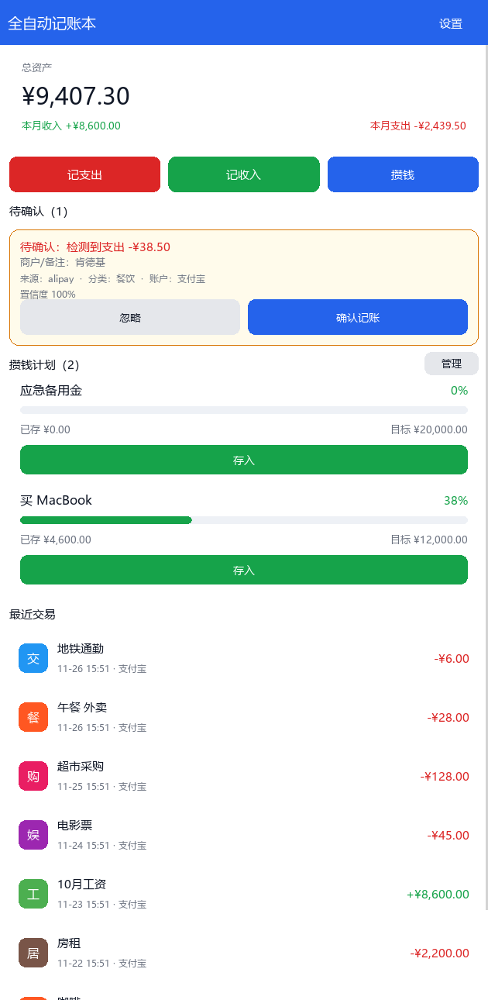
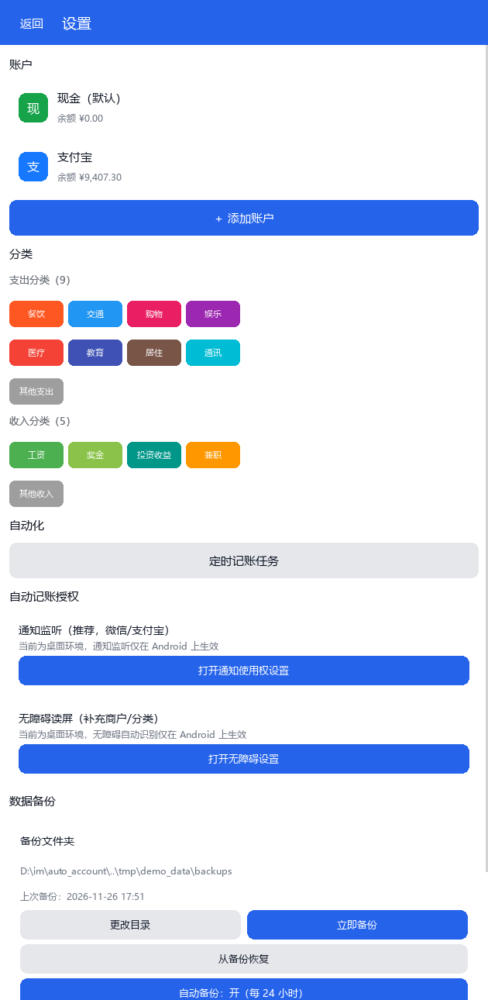

# 全自动记账本（Auto Account）

一款离线优先的 Python 记账应用：桌面可运行，Android 打包后通过**无障碍服务**读取支付宝 / 微信 / 银行 App 的支付页面，自动识别金额与商户，**先弹窗确认，再写入账本**。

## 功能

| 模块 | 说明 |
| --- | --- |
| 基础记账 | 支出 / 收入、二级分类、多账户、备注、日期；账户余额自动联动 |
| 自动识别记账 | 无障碍服务抓取目标 App 页面文字 → 正则提取金额/商户/类型 → 生成「待确认」卡片 → 你确认后才入账 |
| 攒钱计划 | 目标金额、目标日期、进度条；支持「每期自动存入」并生成储蓄流水 |
| 定时记账任务 | 每天/每周/每月/每年/一次性，到点自动生成交易（房租、话费、订阅等） |
| 统计 | 总资产、本月收支、分类占比、最近交易、CSV 导出 |
| 数据备份 | 备份到**你指定的任意文件夹**，自动每日备份，一键从任意备份恢复；备份同时出一份 CSV |
| 离线 | 全部数据存本机 SQLite，无网可用；不做任何上报 |

## 微信 / 支付宝是怎么抓的（两条通道）

打包后需要开**两个**系统授权，它们分工不同：

| 通道 | 授权项 | 抓什么 | 可靠性 |
| --- | --- | --- | --- |
| **通知监听** | 通知使用权 | 支付成功后 App 推送的通知文本，如「微信支付 · 支付成功 ¥25.00」 | 高，后台可用，不受页面样式影响 |
| **无障碍读屏** | 无障碍服务 | 当前屏幕上的文字：商户名、分类关键词、账单列表 | 中，页面用图片画金额时读不到 |

为什么两条都要：微信/支付宝的「支付成功」页经常把金额画成图片或自绘控件，无障碍树里根本没有那段文字；
而它们推送的通知是**明文**的，读通知反而稳。反过来，通知里通常没有商户分类信息，需要读屏补。

命中任一条通道 → 生成「待确认」卡片 → 你确认后才入账。两条通道对同一笔支付可能各触发一次，
去重靠时间与金额接近（待确认卡片可手动忽略）。

### 微信各页面的实际情况

| 页面 | 能否读取 |
| --- | --- |
| 「微信支付」服务号推送 / 通知栏支付成功 | ✅ 明文，最稳 |
| 聊天列表、聊天窗口文本 | ✅ 可读 |
| 钱包 → 账单 列表 | ✅ 可读（适合定期对账） |
| 支付成功瞬间的页面 | ⚠️ 金额常为图片，不保证 |

## 界面预览

| 首页 | 记一笔 |
| --- | --- |
|  |  |

| 攒钱计划 | 定时记账 | 设置 |
| --- | --- | --- |
|  |  |  |

截图由 `scripts/capture.py` 用演示数据自动生成。


## 目录结构

```
auto_account/
├── main.py                     # 桌面/移动端入口
├── buildozer.spec              # Android 打包配置
├── requirements.txt
├── src/
│   ├── models/                 # 数据模型（账户/交易/分类/攒钱/定时/OCR）
│   ├── core/
│   │   ├── database.py         # SQLite 持久化
│   │   └── services.py         # 业务逻辑 + OCR 解析 + 统计
│   ├── ui/
│   │   ├── app.py              # Kivy App、后台调度、Android 回调
│   │   ├── screens.py          # 首页/记账/交易/攒钱/定时/设置
│   │   └── widgets.py          # 主题与通用控件
│   └── android_bridge.py       # 无障碍授权检查（Android 专用）
├── android/
│   ├── src/main/java/com/autoaccount/
│   │   ├── AutoAccountAccessibilityService.java   # 核心：读屏 + 解析 + 广播
│   │   ├── TransactionBroadcastReceiver.java
│   │   ├── PythonCallbackHandler.java             # Java → Python 回调
│   │   └── BootReceiver.java                      # 开机自启
│   └── res/                    # 服务配置、清单片段、字符串
├── scripts/patch_android.py    # 打包后合并清单/资源
└── test_*.py                   # 模型 / 数据库 / UI / 端到端测试
```

## 桌面上运行

```bash
pip install kivy
python main.py
```

Linux/Windows/macOS 均可。桌面环境没有无障碍能力，设置页会提示「仅在 Android 上生效」，其余功能全部可用。

## 测试

```bash
python test_models.py     # 模型层
python test_database.py   # 数据库 + 服务层
python test_backup.py     # 备份/恢复/校验/自动策略/保留裁剪
python test_ui.py         # 构建全部界面并逐个进入
python test_e2e.py        # 端到端：记账→攒钱→定时→自动识别确认→导出→备份恢复
python scripts/smoke_run.py   # 真实启动窗口 5 秒后自动退出
```

`test_e2e.py` 会用临时目录，不污染你的真实数据。想指定数据目录，设置环境变量
`AUTO_ACCOUNT_DATA_DIR`（默认是系统的应用数据目录，取不到时回落到项目 `data/`）。

## 打包 Android APK

需要 Linux 环境，Windows 原生不支持 buildozer。两种方式：

### 方式 A：GitHub Actions 云端打包（无需本机管理员权限，推荐）

仓库里已带 `.github/workflows/build-apk.yml`。

1. 把项目推到 GitHub（`git init && git add . && git commit -m init`，再 push）；
2. 打开仓库 **Actions → Build Android APK → Run workflow**；
3. 等 20～40 分钟，在运行页面的 **Artifacts** 里下载 `autoaccount-apk`。

工作流内部就是下面方式 B 的三条命令，跑在 `kivy/buildozer` 容器里。

### 方式 B：本机 Linux / WSL 打包

```bash
# 只装一次的工具链
sudo apt update && sudo apt install -y python3-pip python3-venv git zip unzip \
    openjdk-17-jdk autoconf libtool pkg-config zlib1g-dev \
    libncurses5-dev libncursesw5-dev libtinfo6 cmake libffi-dev libssl-dev
pip install --user buildozer cython virtualenv

# 打包（release，用项目内固定签名）
buildozer android release          # 首次会下载 SDK/NDK，几个 G，较慢
python scripts/patch_android.py    # 合并无障碍服务清单与资源
buildozer android release          # 再打一次，得到带无障碍服务的 APK
```

产物：`bin/autoaccount-1.0.0-arm64-v8a_armeabi-v7a-release.apk`

## 自己安装（不上架应用商店）

**不需要开发者账号、不需要审核、不需要花一分钱。**

1. 把 `bin/` 里的 `.apk` 通过微信/QQ 传文件、数据线或网盘拷到手机；
2. 手机上点开这个 apk，系统提示「未知来源」时点「设置」→ 允许该来源安装；
   - 小米/红米：可能还要关闭「MIUI 优化」或等待 10 秒验证
   - 华为/荣耀：设置里搜「外部来源应用下载」，允许文件管理器
   - OPPO/vivo：安装时勾选「允许安装未知应用」
3. 安装完成，桌面出现「全自动记账本」。

**升级不丢数据**：项目里带了一套固定签名 `android/autoaccount.keystore`（alias 与密码均为
`autoaccount`），所以以后重新打包安装会**覆盖升级**，账本数据保留。
如果换了签名，系统会拒绝安装，只能先卸载——那就丢数据了，所以这套密钥要留着。

> 这套密钥只用于自己装机，密码公开无妨；**绝不要用它上架任何应用商店**。

### 想装到多台手机 / 送给家人

同一个 apk 可以直接装到任意 Android 手机，互不影响（各自独立数据库）。

> Windows 上装 WSL：需要**管理员权限**执行 `wsl --install -d Ubuntu`，并**重启**。
> 普通用户权限无法开启 WSL 功能。

同一个 apk 可以直接装到任意 Android 手机，互不影响（各自独立数据库）。

## 首次打开后要做的两项授权

1. 打开 App →「设置」→「打开通知使用权设置」→ 允许「全自动记账通知监听」（**主通道，微信/支付宝靠它**）；
2. 回到 App →「打开无障碍设置」→ 开启「全自动记账无障碍服务」（补充商户与分类）；
3. 在支付宝/微信完成一笔支付后回到 App，首页会出现「待确认」卡片，确认即可入账。

> Android 13+ 若收不到通知，请在系统设置里允许本应用发送通知。
> 若安装后设置里看不到无障碍服务，说明清单没合并成功：打开 `python scripts/patch_android.py`
> 输出的 `AndroidManifest.xml`，确认其中含 `AutoAccountAccessibilityService`。

### 无障碍服务支持的目标应用

支付宝、微信、钉钉、QQ、中国银行、工商银行、招商银行、农业银行、交通银行、云闪付、京东金融、淘宝、拼多多。名单在
`android/src/main/java/com/autoaccount/TransactionParser.java` 的 `TARGET_PACKAGES` 中，可自行增删。

## 数据备份

设置页 →「数据备份」：

| 操作 | 说明 |
| --- | --- |
| **备份文件夹** | 点「更改目录」填任意路径：`D:\记账备份`、`/sdcard/Download/AutoAccount`、U 盘、同步盘都行 |
| **立即备份** | 立刻生成一份快照，命名 `auto_account_backup_YYYYMMDD_HHMMSS.db`，并附一份同名 `.csv` |
| **自动备份** | 默认开，每 24 小时一次（App 启动或后台巡检时触发） |
| **从备份恢复** | 列出该文件夹里所有备份，按时间倒序，点一个就恢复 |

几个细节：

- 备份用 SQLite 官方 backup API 生成**一致性快照**，不是复制文件，写到一半也不会坏；
- 恢复前会 `PRAGMA integrity_check` 校验，**非法文件直接拒绝**，不会覆盖你的数据；
- 覆盖前会先把当前库留一份 `auto_account.db.before-restore`，恢复错了还能救回来；
- 自动保留最新 20 份，更早的连同 CSV 一起清掉（可改 `keep`）；
- 备份目录与开关存在 `backup_config.json`，恢复旧数据库**不会把这些设置一起改掉**。

## 隐私

- 屏幕文字只在本机用正则解析，**不截图、不上传、不存储原始页面**；
- 识别结果先进「待确认」，**不会自动扣账**；
- 所有账目存在 `auto_account.db`，卸载即删除。

## 已知限制 / 后续可做

- 银行 App 页面结构差异大，规则需按 App 逐个调优（当前是通用关键词 + 正则）；
- 自动存入目前是三十分钟巡检一次，暂未按「每月/每周」精确对齐日期；
- 没有云同步；如需多设备，可基于 CSV 导入导出扩展。
